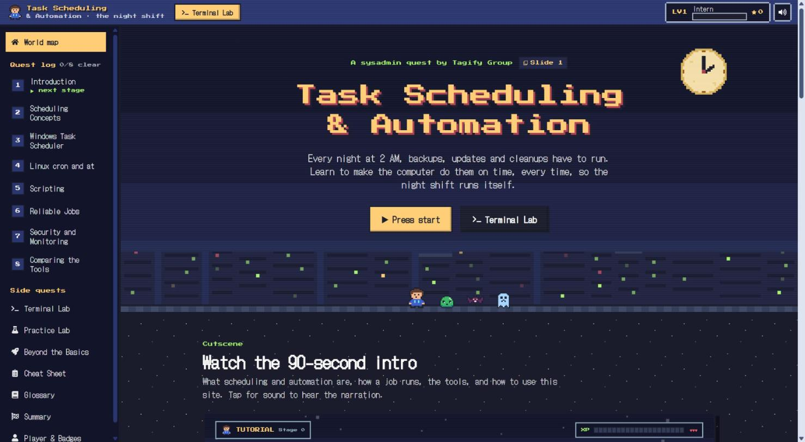
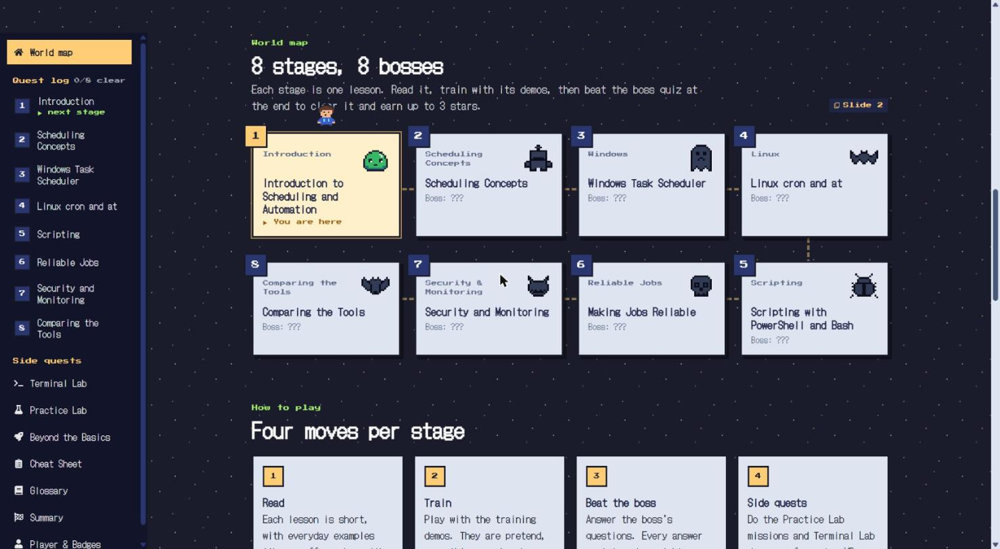
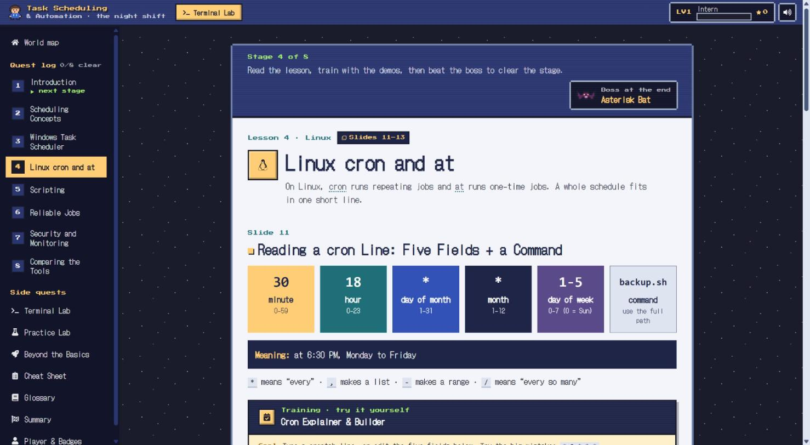
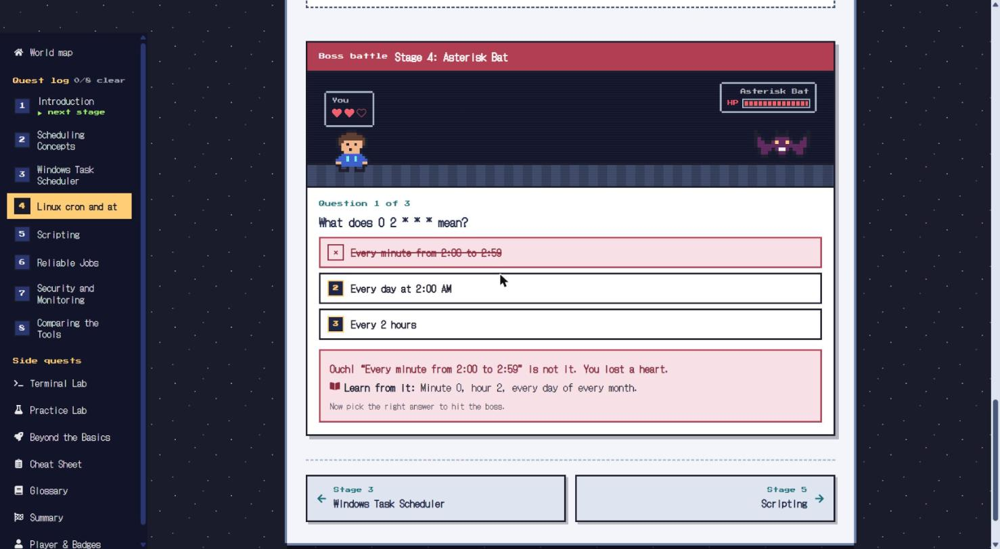
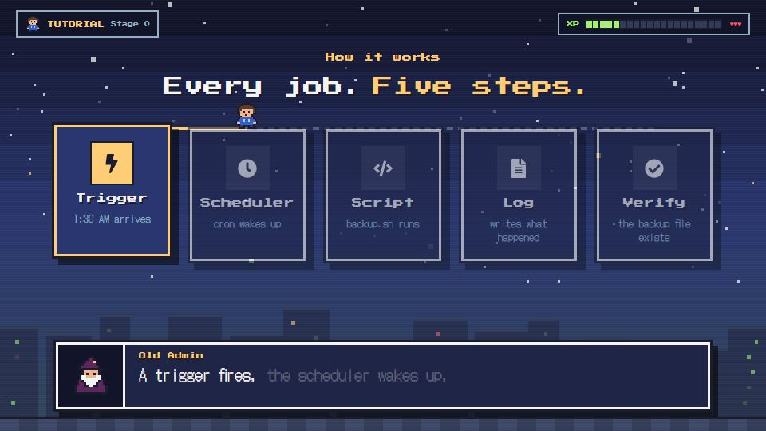

<div align="center">

# Task Scheduling & Automation: The Night Shift

**Learn how system administrators make computers do the 2 AM work by themselves, by playing a retro pixel RPG.**

[](https://tagify-night-shift.vercel.app)

[](https://github.com/jasper890/tagify-night-shift/actions/workflows/ci.yml)
[](https://github.com/jasper890/tagify-night-shift/actions/workflows/nightly-check.yml)
[](LICENSE)



</div>

An open-source, self-study website for the topic **"Task Scheduling and Automation in System Administration"**, made by **Tagify Group**. It follows a 23-slide class presentation lesson by lesson and teaches it through play: each lesson is a stage, each quiz is a boss battle, and every interactive demo is a training ground.

- **No backend, no database, no login.** It is a static site; everything runs in the browser.
- **Nothing real is ever executed.** Every terminal and script is a simulation with prepared output, using only sandbox paths (`C:\Lab\...`, `/home/student/lab/...`).
- **Made for 2nd–3rd year IT students:** short sentences, everyday analogies, and every key word linked to a glossary.

## Contents

- [Features](#features)
- [Screenshots](#screenshots)
- [Quick start](#quick-start)
- [Deploy your own](#deploy-your-own)
- [What students learn](#what-students-learn)
- [How the game works](#how-the-game-works)
- [Terminal Lab](#terminal-lab)
- [Intro video](#intro-video)
- [Project structure](#project-structure)
- [Contributing](#contributing)
- [Credits and third-party licenses](#credits-and-third-party-licenses)
- [License](#license)

## Features

| | |
|---|---|
| 🗺️ **8 stages, 8 bosses** | One stage per lesson on a world map. Read it, train with its demos, then beat the boss quiz to clear it and earn up to 3 stars. |
| ⚔️ **Boss battles that teach** | A wrong answer costs a heart **and shows the explanation**, then you try again. The victory screen recaps every answer. |
| 🧪 **Interactive simulators** | Cron builder with a mistake detector, job-queue simulator, Task Scheduler explorer, safe-cleanup previewer, log viewer, and more. |
| 💻 **Terminal Lab** | 6 guided labs in a simulated Bash or PowerShell terminal: write scripts, schedule them with cron or Task Scheduler, run Ansible and GitHub Actions. |
| 🎬 **Narrated intro video** | A 90-second game-style tutorial built with Remotion, with an 8-bit soundtrack and the Old Admin as narrator. |
| ⭐ **XP, levels and badges** | 8 levels from *Intern* to *Night Shift Legend* and 13 badges, all saved in the browser. |
| 📋 **Cheat sheet and glossary** | A printable one-page cheat sheet and a searchable glossary. |
| 🎓 **Classroom-ready** | Every page links to its slides, nothing is locked, keys 1–4 answer boss questions, and one button starts a new game before a demo. |

## Screenshots

| World map | A lesson (stage) |
|---|---|
|  |  |
| **Boss battle** | **Intro video** |
|  |  |

## Quick start

You need [Node.js](https://nodejs.org/) 20 or newer.

```bash
git clone https://github.com/jasper890/tagify-night-shift.git
cd tagify-night-shift
npm install
npm run dev        # open http://localhost:5173
```

| Command | What it does |
|---|---|
| `npm run dev` | Start the dev server |
| `npm test` | Run the unit tests (Vitest) |
| `npm run build` | Type-check and build the production site into `dist/` |
| `npm run preview` | Serve the built site locally |
| `npm run check-links` | Check internal routes and external documentation links |
| `npm run video:studio` | Open the intro video in Remotion Studio to edit it |
| `npm run video:render` | Export `out/intro.mp4` and the website soundtrack |

**Tech stack:** Vite, React, TypeScript, Tailwind CSS v4, React Router, Remotion, react-icons, cronstrue, cron-parser, Prism and Vitest. Dependency versions are pinned in `package.json`.

## Deploy your own

[](https://vercel.com/new/clone?repository-url=https%3A%2F%2Fgithub.com%2Fjasper890%2Ftagify-night-shift&project-name=tagify-night-shift)

The project works on Vercel as-is: `vercel.json` sets the Vite framework, the `dist` output folder, and a rewrite so that refreshing a page like `/lesson/4` works.

1. Fork this repository (or click the button above).
2. Go to [vercel.com/new](https://vercel.com/new), import your fork, and click **Deploy**. No settings or environment variables are needed.
3. Every push to `main` redeploys the site.

**Optional:** set the environment variable `VITE_REPO_URL` to your repository's address (for example `https://github.com/your-name/tagify-night-shift`). The GitHub Actions page will then link to your repository's real scheduled workflow.

Any static host works too: run `npm run build` and serve the `dist/` folder, with every route falling back to `index.html`.

## What students learn

Each route matches slides in the class presentation (`Task_Scheduling_and_Automation_Tagify_Group.pptx`), so a presenter can move from a slide to the matching page.

| Route | Page | Slides |
|---|---|---|
| `/` | Title screen, intro video, world map of the 8 stages, and the tools of automation | 1–2 |
| `/lesson/1` | Introduction: scheduling = *when*, automation = *how* | 3–5 |
| `/lesson/2` | Scheduling concepts, with the Phone Night-Update and Job Queue simulators | 6–7 |
| `/lesson/3` | Windows Task Scheduler, with the Tab Explorer and Last Run Result decoder | 8–10 |
| `/lesson/4` | Linux cron and at, with the Cron Explainer & Builder | 11–13 |
| `/lesson/5` | PowerShell and Bash, with the Safe Cleanup Previewer | 14–15 |
| `/lesson/6` | Making jobs reliable, with the "Works by hand, fails when scheduled" Troubleshooter | 16–17 |
| `/lesson/7` | Security and monitoring, with Security Before/After and the Log Viewer | 18–19 |
| `/lesson/8` | Comparing the tools, with the Tool Comparison Table and 24-Hour Lab Clock | 20–21 |
| `/summary` | The three habits; thank you | 22–23 |
| `/beyond`, `/beyond/:tool` | GitHub Actions, Ansible, systemd timers, Kubernetes CronJob, Jenkins, PowerShell ScheduledTasks, cloud schedulers | extra |
| `/terminal`, `/terminal/:track` | Terminal Lab: 6 guided labs | all |
| `/practice` | Practice Lab: 11 guided missions with the simulators | all |
| `/cheatsheet` | Printable cheat sheet | all |
| `/glossary` | Searchable glossary | all |
| `/player` | Player profile: level, XP, stars, bosses defeated, badges, and **Start a new game** | — |

## How the game works

The game is a skin over the lessons: the lesson text, simulators and quiz questions are the course itself, and every game moment teaches something.

| Piece | How it works |
|---|---|
| Stages and world map | The 8 lessons are stages on a path; the next one is marked "You are here". Nothing is locked, so a teacher can open any lesson during a class. |
| Boss battles ([`Quiz.tsx`](src/components/Quiz.tsx)) | Each boss stands for a bad habit ([`bosses.ts`](src/data/bosses.ts)), from the Toil Slime to the 2 AM Dragon. A right answer hits the boss; a wrong one costs one of 3 hearts and shows the explanation. Stars = hearts left. Keys 1–4 answer and Enter moves on. |
| The Old Admin | The pixel mentor who tells each lesson's everyday analogy in an RPG dialog box, and narrates the intro video. |
| XP, levels, badges ([`game.ts`](src/lib/game.ts)) | Worked out from saved progress: 100 XP per stage, 25 per star, 40 per mission, 10 per Terminal Lab step. Level-up and badge popups appear once. |
| Saving | Progress is stored only in the browser with `localStorage`. There are no accounts and nothing is sent anywhere. |
| Sound | Short 8-bit effects made with the Web Audio API ([`sfx.ts`](src/lib/sfx.ts)), only after a click or key press. The speaker button mutes them. |
| Pixel art | Sprites are 16×16 character grids drawn as SVG rectangles ([`sprites.ts`](src/components/pixel/sprites.ts)), so they stay sharp at any size. |
| Fonts | DotGothic16 for reading text, chosen because its digits and symbols stay clear (2 never looks like 8, `*` is large), which matters in a cron course. Press Start 2P only for titles and short labels. |

**Before a class demo:** open **Player & Badges** and press **Start a new game** to reset to Stage 1.

## Terminal Lab

A guided, simulated terminal (Linux Bash or Windows PowerShell) that runs entirely in the browser. Each step explains one idea, shows exactly what to type, checks the student's work, and shows realistic output. An editor opens for `nano`, `notepad` and `crontab -e`, with live warnings for cron mistakes and YAML errors. The simulator-only command `timewarp 6h` fast-forwards the clock so students can watch scheduled jobs run.

| Lab | What students do |
|---|---|
| Your first Bash script | `pwd`, `cd`, `ls -l`, write `backup.sh`, hit "Permission denied", `chmod +x`, run it, read the log |
| Schedule it with cron | `crontab -e`, `timewarp`, `grep CRON /var/log/syslog`, then break and fix a relative-path job |
| Clean up safely + one-time jobs | `find -mtime +7 -print` then `-delete`; `echo ... \| at now + 2 hours`, `atq` |
| PowerShell & Task Scheduler | `Get-ChildItem \| Where-Object \| Remove-Item -WhatIf`, write a `.ps1`, `schtasks /create /run /query /delete`, compare Last Result 0 and 2 |
| Ansible for network automation | Inventory for 3 Cisco devices, `ansible -m ping`, a backup playbook (`cisco.ios.ios_config`), `--check`, `--diff`, idempotence, a nightly cron |
| GitHub Actions | Write a workflow (UTC schedule, `workflow_dispatch`, secrets), `git add/commit/push`, `gh workflow run`, `gh run view --log` |

The engine lives in [`src/terminal/`](src/terminal). [`terminal.test.ts`](src/terminal/terminal.test.ts) plays every step of every lab to make sure the whole course can be completed.

## Intro video

The home page opens with a narrated, game-style tutorial (~90 s) built with [Remotion](https://www.remotion.dev/) in [`src/video/`](src/video). Every graphic appears on the word that names it. The captions are an RPG dialog box where the Old Admin speaks word by word, a HUD shows a tutorial XP bar, and an original 8-bit chiptune soundtrack dips under a cartoon-style narrator voice.

It covers: the 2 AM problem; scheduling = when, automation = how; the five steps of a job; reading a cron line (`30 1 * * *`); the tools from Task Scheduler to Kubernetes CronJobs; the five shared ideas; a 24-hour night of jobs; the three habits; and how to use the site.

| Piece | What it is |
|---|---|
| [`scripts/generate-audio.py`](scripts/generate-audio.py) | Makes the narration with [edge-tts](https://github.com/rany2/edge-tts) (voice `en-US-RogerNeural`, pitched up, with a light retro filter) and per-word timings, synthesizes the chiptune music and 8-bit effects from square, triangle and noise waves, and writes `src/video/audio.json`. Needs Python (`pip install edge-tts numpy`), ffmpeg and an internet connection. |
| [`src/video/timeline.ts`](src/video/timeline.ts) | Sizes every scene from its narration and turns words into animation cues, for example `cue('cron')`. |
| `npm run video:render` | Renders `out/intro.mp4` and the pre-mixed `public/video/soundtrack.mp3`, both normalized to -16 LUFS. |
| [`IntroVideo.tsx`](src/components/IntroVideo.tsx) | Plays the animation with `@remotion/player` and keeps the soundtrack in sync. It autoplays silently with captions; **Tap for sound** restarts it with narration. |

To change the script: edit `NARRATION` in `scripts/generate-audio.py`, run it, adjust the cue words in `src/video/scenes/` if needed ([`cues.test.ts`](src/video/cues.test.ts) fails if a cue word is no longer spoken), then run `npm run video:render`.

## Project structure

```
src/
  components/     Layout (HUD header, quest-log sidebar, game window), Quiz (boss battle), CodeBlock, shared UI
    pixel/        Sprites, HUD, level-up and badge popups, title-screen scenery
  demos/          The interactive simulators
  data/           Lessons, quizzes, bosses, Practice Lab missions, glossary, tool pages, comparison table
  lib/            Pure logic with unit tests (cron warnings, cleanup filter, job queue, result codes,
                  XP/levels/badges), progress saving, sound effects
  terminal/       Simulated Linux and PowerShell shells, Ansible/git/GitHub simulators, and the guided labs
  video/          The Remotion intro video (scenes, theme, timeline)
  pages/          One file per route
public/video/     Narration, music, sound effects and the website soundtrack
scripts/          Audio generator, video render script, broken-link checker
docs/screenshots/ Images used in this README
.github/workflows/ CI on every push, and a nightly scheduled check
```

**The repository schedules itself:** [`nightly-check.yml`](.github/workflows/nightly-check.yml) is a scheduled workflow (`cron: '0 18 * * *'`, which is 18:00 UTC or 2:00 AM Philippine time) that runs the tests, the build and the link check every night. That is the course topic in action.

## Contributing

Contributions are welcome: fixes, clearer explanations, new quiz questions, translations, new simulators or Terminal Lab steps.

1. Fork the repository and create a branch: `git checkout -b my-change`.
2. Make your change and keep the language simple; the site is for students meeting these ideas for the first time.
3. Run the checks:
   ```bash
   npm test && npm run build && npm run check-links
   ```
4. Open a pull request that explains what you changed and why. CI runs the same checks.

**Where things live**

| To change… | Edit |
|---|---|
| A lesson's text or demos | `src/pages/LessonN.tsx` and `src/demos/` |
| Quiz (boss battle) questions | `src/data/quizzes.ts`: each question needs a short `why` explanation |
| A boss's name or lines | `src/data/bosses.ts` |
| Glossary entries | `src/data/glossary.ts` |
| Practice Lab missions | `src/data/missions.ts` |
| Terminal Lab steps | `src/terminal/tracks.ts`, then update `TRACK_STEPS` in `src/lib/game.ts` (a test checks they match) |
| XP, levels, badges | `src/lib/game.ts` and `src/lib/game.test.ts` |
| Colors and fonts | `src/index.css` (`@theme` tokens) |

**Ground rules:** never add commands that touch real systems, keep examples on sandbox paths, never put real credentials in examples, and link to official documentation for any tool option you show.

### Notes on accuracy

- The original brief asked for `ansible.windows.win_scheduled_task`. That module actually lives in the **community.windows** collection, so the site uses `community.windows.win_scheduled_task`.
- Every tool page links to the official documentation for the options it shows. If you spot something outdated, please open an issue.

## Credits and third-party licenses

Made by **Tagify Group** for a college IT class presentation. The original project brief is in [`Claude_Code_Prompt_Demo_Website.md`](Claude_Code_Prompt_Demo_Website.md).

| Used | License / terms |
|---|---|
| [DotGothic16](https://fonts.google.com/specimen/DotGothic16) and [Press Start 2P](https://fonts.google.com/specimen/Press+Start+2P) fonts | SIL Open Font License 1.1 |
| [Remotion](https://www.remotion.dev/) (intro video) | [Remotion License](https://www.remotion.dev/license): free for individuals, non-profits and small teams; larger companies need a company license |
| [react-icons](https://react-icons.github.io/react-icons/) | MIT (individual icon sets keep their own licenses; brand logos are trademarks of their owners) |
| Narration voice | Generated with Microsoft's online neural text-to-speech through edge-tts |
| Music, sound effects and pixel art | Original, made for this project; covered by this repository's license |

All product names and logos (Windows, Linux, GitHub, Ansible, Jenkins, Kubernetes, AWS, Azure, Google Cloud) belong to their owners and are used only to identify the tools being taught.

## License

The code and content of this repository are released under the [MIT License](LICENSE), except for the third-party parts listed above, which keep their own licenses.
